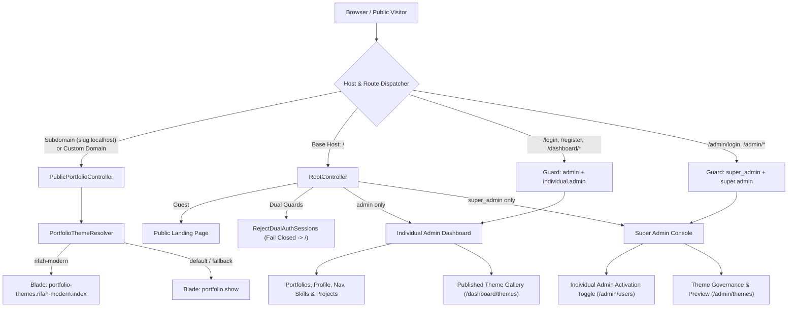
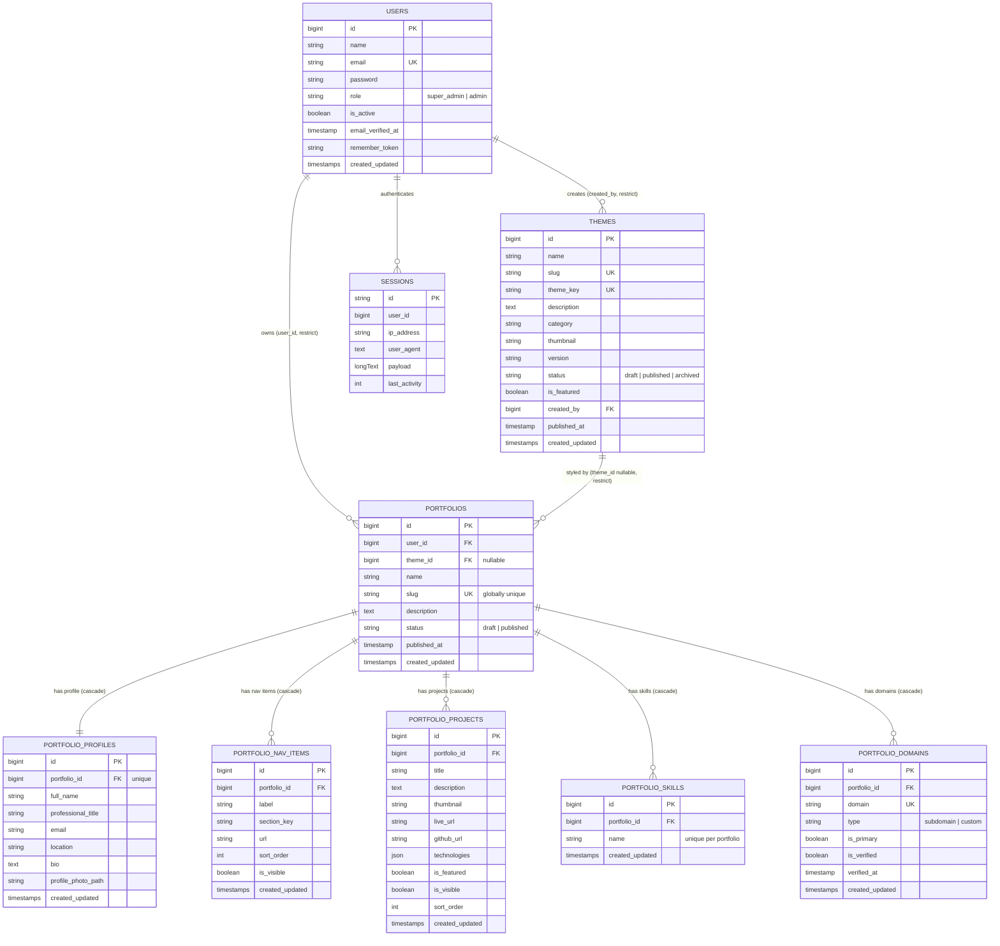
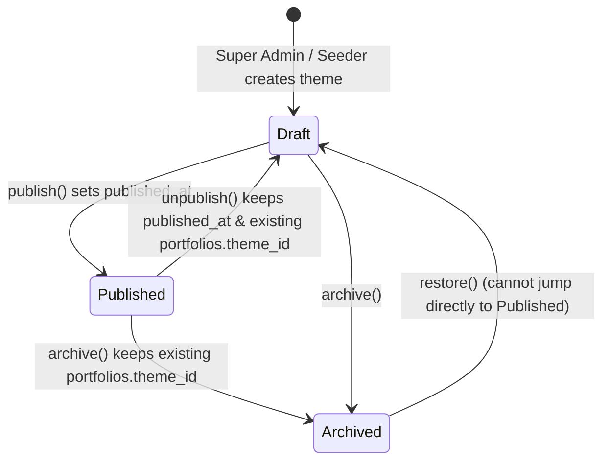
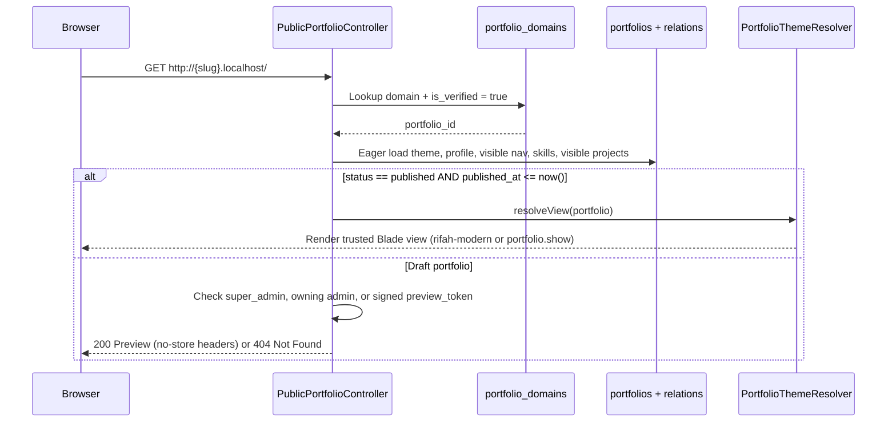
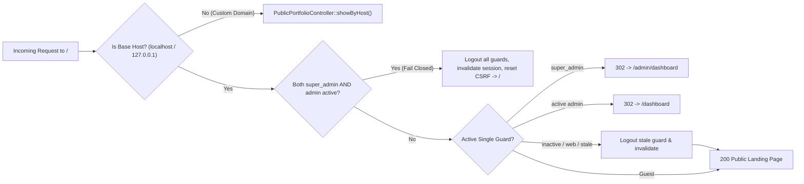

# Portfolio CMS

A multi-tenant portfolio management platform built with **Laravel 13**, **Tailwind CSS v4**, and **Vite**. Portfolio CMS separates platform governance from creator workspaces, giving every portfolio its own domain/subdomain identity, modular content sections, signed draft previews, and curated theme switching.

---

## Table of Contents

- [Visual Feature Architecture](#visual-feature-architecture)
- [Key Capabilities](#key-capabilities)
- [Database Schema & ER Diagram](#database-schema--er-diagram)
- [Database Working Procedures](#database-working-procedures)
- [Authentication & Root Routing Flow](#authentication--root-routing-flow)
- [Tech Stack & Project Structure](#tech-stack--project-structure)
- [How to Run on Your Own Machine / Application](#how-to-run-on-your-own-machine--application)
- [Testing & Code Quality](#testing--code-quality)
- [License](#license)

---

## Visual Feature Architecture



---

## Key Capabilities

### Dual-Role Architecture & Mutually Exclusive Sessions
- **Strict Role Separation**: Separate `super_admin` and `admin` authentication guards backed by `EnsureSuperAdmin` and `EnsureIndividualAdmin` middleware.
- **Single Active Session Policy**: Logging in or registering on either portal clears any opposing privileged guard, strips cross-portal `url.intended` redirects, destroys the prior session row (`regenerate(true)`), and rotates the CSRF token.
- **Fail-Closed Dual-Session Recovery**: `RejectDualAuthSessions` executes before authentication/guest middleware on every `web` request to invalidate conflicting guards, rotate CSRF state, and redirect safely to `/` without leaking names, emails, or roles.
- **Account & Session Security**: Login rate limiting, bcrypt hashing, explicit logout invalidation, `Cache-Control: no-store` headers on privileged dashboards, and active-status checks (`is_active`).

### Creator Workspace (Individual Admins)
- **Self-Registration & Account Controls**: Individual Admins register at `/register` (`ROLE_ADMIN` enforced server-side), manage profile details, and rotate passwords + active sessions at `/dashboard/account`.
- **Multi-Portfolio Management**: Create, update, publish/unpublish, preview, and delete multiple isolated portfolios scoped strictly by ownership (`PortfolioPolicy`).
- **Modular Portfolio Sections**: Per-portfolio management for owner profile details, navigation items (reordering, visibility, section links or external URLs), skills, and featured/visible projects.
- **Published Theme Gallery (`/dashboard/themes`)**: Browse published themes only, switch between owned portfolios, preview themes safely with owned content (without changing `portfolios.theme_id`), and apply themes atomically via `ThemeApplicationService`.

### Platform Governance (Super Admins)
- **Admin & Portfolio Oversight (`/admin`)**: View platform metrics, search/filter portfolios, toggle Individual Admin status (`is_active`), and manage portfolios.
- **Curated Theme Lifecycle (`/admin/themes`)**: Preview themes using a non-personal demo fixture and govern visibility via `Draft` → `Published` → `Archived` → `Draft` transitions (`ThemePublishingService`), preserving existing portfolio assignments and publication history.

### Public Portfolio Delivery & Transactional Email
- **Multi-Host Routing**: Serves `{slug}.{PORTFOLIO_BASE_DOMAIN}` subdomains (e.g., `http://mahfuj.localhost:8000`), verified custom domains on `/`, and optional base-domain `/{slug}` fallback (`PORTFOLIO_LEGACY_SLUG_FALLBACK`).
- **Trusted Theme Resolution**: `PortfolioThemeResolver` maps approved `theme_key` values (`default`, `rifah-modern`) against a static allowlist and falls back safely to `portfolio.show`.
- **Secure Draft Previews**: Owner/Super Admin previews plus signed preview tokens (`PortfolioPreviewService`) served with `Cache-Control: no-store`, `Referrer-Policy: no-referrer`, and `X-Robots-Tag: noindex, nofollow`.
- **Transactional Mail**: Integrated with `resend/resend-laravel` (`v1.7`) for outbound delivery via `RESEND_API_KEY`.

---

## Database Schema & ER Diagram

All core tables, foreign key rules (`RESTRICT` vs `CASCADE`), and indexes reflect the actual database migrations:



---

## Database Working Procedures

### 1. Atomic Portfolio Creation Flow (`PortfolioService::create`)
Every portfolio creation runs inside a single database transaction (`DB::transaction`) so partial records never persist on validation or domain collision errors:

1. **Parent Record (`portfolios`)**: Forces `status = 'draft'` and `published_at = null`, binds `user_id` strictly from the actor, and verifies global slug uniqueness (`portfolios_slug_unique`).
2. **Profile (`portfolio_profiles`)**: Creates a 1:1 profile linked by unique `portfolio_id`.
3. **Navigation (`portfolio_nav_items`)**: Validates a mandatory `home` item (`sort_order = 1`, max 10 items) and enforces mutual exclusivity between `section_key` and external `url`.
4. **Skills & Projects (`portfolio_skills`, `portfolio_projects`)**: Persists ordered skills (unique `(portfolio_id, name)`) and JSON-tagged project cards.
5. **Primary Subdomain (`portfolio_domains`)**: `PortfolioDomainService::createDefaultSubdomain()` validates reserved labels (`admin`, `api`, `dashboard`, etc.) and creates a verified `subdomain` entry (`{slug}.{PORTFOLIO_BASE_DOMAIN}`).
6. **Publishing (`PortfolioService::publish`)**: Sets `status = 'published'` and `published_at = now()`; unpublishing returns to `'draft'` and resets `published_at = null`. Deleting a portfolio cascades cleanly across all 5 child tables while `users.id` delete is restricted if portfolios exist.

### 2. Theme Governance & Per-Portfolio Switching



- **Strict Delete Guard**: Both `themes.created_by` and `portfolios.theme_id` use `RESTRICT ON DELETE`. `ThemeService::delete()` acquires a row lock (`lockForUpdate()`) and blocks deletion whenever any portfolio references the theme.
- **Per-Portfolio Application (`ThemeApplicationService::apply`)**:
  1. Locks the target `themes` and `portfolios` rows inside `DB::transaction`.
  2. Verifies the actor is an active `admin`, owns the portfolio (`portfolio.user_id === actor.id`), and the theme is currently `Published`.
  3. Updates **only** `portfolios.theme_id` — sibling portfolios and all content tables (`profiles`, `nav_items`, `skills`, `projects`) remain untouched.

### 3. Public Host & Theme Resolution Flow



---

## Authentication & Root Routing Flow



| Auth Mechanism | Details |
|---|---|
| Guards (`config/auth.php`) | `super_admin` (session/users), `admin` (session/users), `web` (never treated as privileged) |
| Session Storage | Database `sessions` table (`SESSION_DRIVER=database`), `http_only=true`, `same_site=lax` |
| Cross-Portal Switch | Logging into `/login` while on `super_admin` (or `/admin/login` while on `admin`) clears the previous guard and destroys its session row via `regenerate(true)` |

---

## Tech Stack & Project Structure

| Layer | Technology |
|---|---|
| Backend Framework | PHP `^8.3` (verified on `8.4.0`), Laravel `^13.0` |
| Frontend & Styling | Blade, Tailwind CSS `^4.0` (`@tailwindcss/vite`), Vite `^7.0`, Axios |
| Email / Transactional Mail | `resend/resend-laravel` `^1.7` |
| Database & State | MySQL / SQLite, Database Sessions, Cache & Queue Tables |
| Testing & Formatting | PHPUnit `^12.5`, Mockery, Faker, Laravel Pint |

```text
app/
├── Enums/ThemeStatus.php                 # Draft, Published, Archived enum
├── Http/
│   ├── Controllers/
│   │   ├── Auth/                         # AdminAuthController, SuperAdminAuthController
│   │   ├── Admin/                        # Super Admin Dashboard/Users/Portfolios + Individual Admin ThemeController
│   │   ├── SuperAdmin/ThemeController.php# Super Admin Theme CRUD, preview & lifecycle endpoints
│   │   ├── Dashboard/AccountDashboardController.php # Individual Admin portfolios & account settings
│   │   ├── PublicPortfolioController.php # Public host/slug & signed preview controller
│   │   └── RootController.php            # Base host vs custom domain "/" router
│   ├── Middleware/
│   │   ├── EnsureBaseDomain.php          # Blocks admin/auth routes on portfolio subdomains
│   │   ├── EnsureIndividualAdmin.php     # Active 'admin' guard + no-store headers
│   │   ├── EnsureSuperAdmin.php          # Active 'super_admin' guard + no-store headers
│   │   └── RejectDualAuthSessions.php    # Central fail-closed dual-session recovery
│   └── Requests/                         # Validated Form Requests across portals
├── Models/                               # User, Portfolio, Theme & nested Portfolio* models
├── Policies/                             # PortfolioPolicy, ThemePolicy
└── Services/                             # Portfolio*, Theme*, UserService
```

---

## How to Run on Your Own Machine / Application

Follow these exact steps to install, configure, seed, and run Portfolio CMS locally or integrate it into your own environment.

### Step 1: Prerequisites
- **PHP `>= 8.3`** (`curl`, `openssl`, `mbstring`, `pdo_mysql` or `pdo_sqlite`, `tokenizer`, `xml`, `ctype`, `fileinfo`)
- **Composer `2.x`**
- **Node.js `>= 20`** & **npm**
- **MySQL 8.x** (recommended) or **SQLite**

### Step 2: Clone & Install Dependencies

```bash
git clone https://github.com/khanmahfuj34/portfolio-cms.git
cd portfolio-cms

composer install
npm install
```

### Step 3: Configure `.env`

Create your `.env` file and generate an application encryption key:

```bash
cp .env.example .env
php artisan key:generate
```

Update `.env` with your database, domain, Super Admin seed credentials, and mail configuration:

#### Option A — MySQL Configuration (Recommended)
```dotenv
APP_NAME="Portfolio CMS"
APP_ENV=local
APP_DEBUG=true
APP_URL=http://localhost:8000

DB_CONNECTION=mysql
DB_HOST=127.0.0.1
DB_PORT=3306
DB_DATABASE=portfolio_cms
DB_USERNAME=root
DB_PASSWORD=your_db_password
```

#### Option B — SQLite Quick Setup
```dotenv
DB_CONNECTION=sqlite
# Remove/comment DB_HOST, DB_PORT, DB_DATABASE, DB_USERNAME, DB_PASSWORD
```
And create an empty SQLite file (`touch database/database.sqlite` or `New-Item database/database.sqlite` on Windows).

#### Required Application, Seeder & Mail Variables
```dotenv
# Session & Routing
SESSION_DRIVER=database
SESSION_LIFETIME=120
PORTFOLIO_BASE_DOMAIN=localhost
PORTFOLIO_LEGACY_SLUG_FALLBACK=true

# Super Admin account created by php artisan db:seed
ADMIN_NAME="Super Admin"
ADMIN_EMAIL=superadmin@example.com
ADMIN_PASSWORD=StrongPassword123!

# Resend Mail Configuration (optional for local dev; use MAIL_MAILER=log if offline)
MAIL_MAILER=resend
RESEND_API_KEY=re_your_resend_api_key
MAIL_FROM_ADDRESS=onboarding@resend.dev
MAIL_FROM_NAME="Portfolio CMS"
```

> **Windows HTTPS / Resend SSL Setup:** If PHP raises `cURL error 60: SSL certificate problem: unable to get local issuer certificate`, download `https://curl.se/ca/cacert.pem` (e.g. to `C:\Users\<YOU>\.config\php\cacert.pem`), set `curl.cainfo` and `openssl.cafile` in your active `php.ini` (`php --ini`), and restart `php artisan serve`.

### Step 4: Run Migrations, Seed Super Admin & Build Assets

```bash
# Run database migrations (creates users, portfolios, themes, domains, sessions, etc.)
php artisan migrate

# Create the initial Super Admin account from ADMIN_NAME / ADMIN_EMAIL / ADMIN_PASSWORD
php artisan db:seed

# Create public/storage symlink if using local uploaded profile/project images
php artisan storage:link

# Compile Tailwind CSS v4 + theme/app Vite bundles
npm run build
```

> **Initial Theme Registration Note:** To make the prebuilt **Rifah Modern** theme (`rifah-modern`) selectable for Individual Admins after a fresh migration, ensure a `themes` record exists with `theme_key = 'rifah-modern'` and publish it from `/admin/themes` as Super Admin (or create it via `ThemeService` / Super Admin seeder).

### Step 5: Start the Application

Run everything together (Laravel HTTP server + queue worker + log viewer + Vite HMR):

```bash
composer dev
```

Or run manually in two terminals:

```bash
# Terminal 1: PHP HTTP Server
php artisan serve --host=localhost --port=8000

# Terminal 2: Vite Frontend Watcher
npm run dev
```

### Step 6: Using the Application End-to-End

1. **Open the Public Landing Page**: `http://localhost:8000/`
2. **Sign in as Super Admin**: `http://localhost:8000/admin/login` (using `ADMIN_EMAIL` / `ADMIN_PASSWORD`) → manage themes at `/admin/themes` (`Preview`, `Publish`, `Unpublish`, `Restore`) and manage creator accounts at `/admin/users`.
3. **Register or Sign in as an Individual Admin**: `http://localhost:8000/register` or `http://localhost:8000/login` (note: signing into a portal in the same browser automatically logs out any active opposing portal session).
4. **Create & Publish a Portfolio**: Visit `/dashboard/portfolios/create` → enter name, unique slug (e.g., `myname`), profile bio, navigation items, skills, and projects → click **Publish**.
5. **Switch Theme**: Visit `/dashboard/themes`, choose your target portfolio in the selector, preview any published theme live with your content, and click **Apply Theme**.
6. **View Live Portfolio**:
   - **Subdomain URL**: `http://myname.localhost:8000/` (modern browsers resolve `*.localhost` natively to loopback without editing `hosts`)
   - **Legacy Slug Fallback URL**: `http://localhost:8000/myname` (when `PORTFOLIO_LEGACY_SLUG_FALLBACK=true`)

### Step 7: Production Deployment Checklist
- Set `APP_ENV=production`, `APP_DEBUG=false`, `APP_URL=https://yourdomain.com`, and `PORTFOLIO_BASE_DOMAIN=yourdomain.com`.
- Configure wildcard DNS (`*.yourdomain.com` → server IP) for subdomain portfolios, plus SSL certificates for custom domains.
- Set `SESSION_SECURE_COOKIE=true` over HTTPS and run `php artisan config:cache`, `php artisan route:cache`, `php artisan view:cache`, and `npm run build`.

---

## Testing & Code Quality

Run the full automated test suite (clears config cache first):

```bash
composer test
# or
php artisan test
```

The test suite contains **240 tests (2,075 assertions)** covering:
- **Authentication & Security**: `MutuallyExclusiveAuthenticationTest`, `PortalGuardIsolationTest`, `AdminAccountAuthTest`, `MultiAdminSecurityAuditTest`
- **Routing & Subdomains**: `SubdomainRoutingTest`, `PublicPortfolioTest`, `ExampleTest`
- **Ownership & Isolation**: `IndividualAdminPortfolioOwnershipTest`, `MultiPortfolioIsolationTest`, `PortfolioPolicyTest`, `OwnerDraftPreviewTest`
- **Themes & Rendering**: `ThemeModelTest`, `ThemePolicyTest`, `ThemeRequestValidationTest`, `ThemeServiceTest`, `ThemePublishingServiceTest`, `ThemeApplicationServiceTest`, `AdminThemeCatalogTest`, `AdminThemeApplicationControllerTest`, `AdminThemeGalleryUITest`, `SuperAdminThemeControllerTest`, `SuperAdminThemeManagementUITest`, `PortfolioThemeResolverTest`, `RifahModernThemeTest`

Format PHP source files using Laravel Pint:

```bash
./vendor/bin/pint
```

---

## License

This project is open-sourced software licensed under the [MIT License](https://opensource.org/licenses/MIT).
